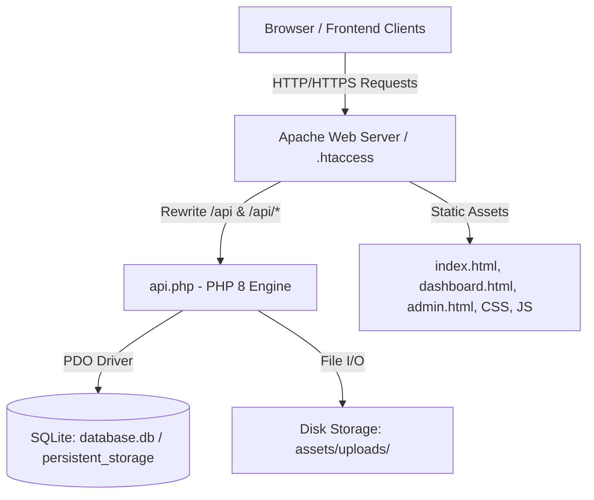

# System Architecture Documentation

## Overview

The application is a full-service agency website and Content Management System (CMS) titled **Egypt Creative**. It consists of a static-first HTML5 frontend driven by a single-file RESTful PHP backend engine using SQLite for persistent data storage.

---

## Architectural Diagram

---

## Technical Stack

- **Server Environment**: Apache HTTP Server with `mod_rewrite`, `mod_headers`, and `mod_deflate`.
- **Backend Language**: PHP 8+ (Single-file monolithic API router `api.php`).
- **Data Persistence**: SQLite 3 database (`database.db` / `egypt_creative_production.db`) accessed via PHP Data Objects (PDO).
- **Session & State Management**: Native PHP Sessions with dual SSL cookie detection (`session.cookie_httponly`, `session.cookie_secure`, `SameSite=Lax`) and persistent HMAC-signed authentication cookies (`egypt_admin_auth`).
- **Frontend Layer**: Semantic HTML5, CSS3 with custom variables, Vanilla JavaScript (ES6+), Chart.js (for analytics rendering).

---

## Component Interaction Flow

1. **Routing Layer (`.htaccess`)**:
   - Directs requests targeting `/api` or `/api/*` to `api.php`.
   - Directs `/admin` requests to `admin.html`.
   - Directs `/case-study/:slug` requests to `case-study.html?slug=:slug`.
   - Applies security response headers and zero-cache policies for dynamic assets.

2. **Backend Engine (`api.php`)**:
   - Evaluates incoming request parameters (`action` key via `GET` or `POST` JSON payload).
   - Initializes session and checks persistent HMAC cookie authentication via `restoreSessionFromCookie($db)`.
   - Enforces Role-Based Access Control (RBAC) via `requireAuth($allowedRoles)`.
   - Executes parameterized PDO queries against SQLite.
   - Formulates structured JSON responses with `Content-Type: application/json`.

3. **Frontend Application**:
   - `index.html`: Public-facing agency landing page. Fetches CMS content dynamically via `api.php?action=get_data`.
   - `admin.html`: Single-page authentication portal for administrators.
   - `dashboard.html`: Enterprise control panel UI for content management, lead CRM, media library, and analytics.

---

## Role-Based Access Control (RBAC) Structure

The application defines four distinct user access roles:

- **Super Admin (`super_admin`)**: Full unrestricted access to system configuration, user account management, SMTP settings, content editing, and lead CRM.
- **Editor (`editor`)**: Access to content management (Pages, Services, Portfolio, Clients, Team, Testimonials, Media Library). Section-level permissions stored in JSON format (`permissions` column).
- **Sales (`sales`)**: Restricted access to lead CRM, contact inquiries, and WhatsApp interaction logs.
- **Viewer (`viewer`)**: Read-only access to dashboard metrics and analytics overview.
