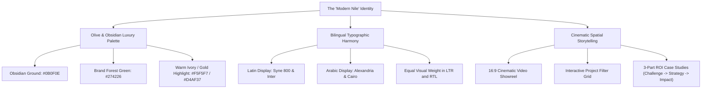

# EGYPT CREATIVE — COMPETITIVE AND QUALITY BENCHMARK
## International Agency Evaluation, Design Systems Analysis & Positioning Opportunities

**Audited Brand:** Egypt Creative — Full-Service Digital Marketing & Creative Agency  
**Target Domain:** `https://egyptcreative.com/`  
**Benchmark Target Agencies:** Locomotive (Montreal), Active Theory (LA/Amsterdam), Basic Agency (San Diego/NYC), Instrument (Portland/NYC), Koto (London/Berlin), Build in Amsterdam  
**Core Purpose:** Extract international agency design benchmarks, avoid regional clichés, and architect a distinctive, globally competitive brand experience preserving Egypt Creative's identity.  
**Audit Date:** November 24, 2026  
**Auditor:** Principal Brand Strategist & Creative Director  

---

## 1. Comparative Analysis of World-Class Creative Agencies

| Agency & Location | Visual Direction & Philosophy | Hero Composition Strategy | Portfolio & Case Study Experience | Motion & Interaction Craft |
| :--- | :--- | :--- | :--- | :--- |
| **Locomotive**<br>*(Montreal)* | Asymmetric editorial layouts, heavy typographic attitude, tactile smoothness. | Massive kinetic headline paired with smooth cursor magnetic follower; zero clutter or corporate badges. | Full-bleed interactive project slider with WebGL distortion shaders and deep narrative case study pages. | Proprietary smooth scroll (`locomotive-scroll`), layout transitions, and subtle element stagger. |
| **Active Theory**<br>*(Los Angeles / Amsterdam)* | Spatial computing, cinematic 3D environments, dark luxury aesthetics. | Real-time WebGL interactive canvas that responds dynamically to mouse/touch gestures; minimal text. | Interactive 3D gallery rooms where visitors explore projects in virtual spatial depth. | Custom micro-shaders, particle physics, spatial sound design, and 60fps rendering pipelines. |
| **Basic Agency**<br>*(San Diego / NYC)* | High-end B2B and DTC digital flagship, Swiss typographic grid, razor-sharp contrast. | Bold, unapologetic editorial headlines (*"Crafting the next generation of brands"*), high-contrast monochrome. | Deep strategic case studies: Business Problem -> Strategic Insight -> Design System -> Market ROI. | Micro-interactions: crisp hover states, magnetic pill buttons, smooth drawer navigations. |
| **Instrument**<br>*(Portland / NYC)* | Human-centered digital agency, serene spatial balance, warm modernism. | Quiet confidence: generous white/negative space, video reel embedded inside geometric container. | Highly legible, editorial case studies detailing cross-disciplinary team impact and client longevity. | Restrained, purposeful transitions; zero gratuitous motion; buttery smooth opacity fades. |
| **Koto**<br>*(London / Berlin / NY)* | World-renowned brand design studio, vivid color blocking, optimistic bravado. | Massive custom brand wordmark with animated SVG typographic transitions; punchy copywriting. | Visual-first identity showcase: massive packaging renders, billboards, physical touchpoints. | Playful typographic elasticity, responsive SVG morphing, and rhythmic scroll reveals. |
| **Build in Amsterdam**<br>*(Amsterdam)* | Editorial digital flagship, haute-couture fashion aesthetic, zero-friction luxury. | Split-screen video lookbook; ultra-minimalist navigation; seamless background music option. | Seamless infinite scroll with instant video playback on hover; luxury e-commerce storytelling. | Instant page transitions with zero reload flash; sub-50ms interaction latency. |

---

## 2. Creative Deconstruction: Egypt Creative's Current Reality vs Benchmarks

When evaluating `https://egyptcreative.com/` against international benchmarks, four distinct areas for elevation emerge:

```
┌────────────────────────────────────────────────────────────────────────┐
│                   CREATIVE GAP DECONSTRUCTION                          │
├──────────────────────────────────┬─────────────────────────────────────┤
│ 1. The Portfolio Archive Gap     │ 2. Case Study Narrative Depth       │
│  - Top agencies: bespoke index   │  - Top agencies: Problem -> ROI     │
│  - Egypt Creative: /project/ has │  - Egypt Creative: Video reel only, │
│    broken ThemeForest demo cards │    lacks written business impact    │
├──────────────────────────────────┼─────────────────────────────────────┤
│ 3. Dual-Language Cultural Bridge │ 4. Motion & Tactile Feel            │
│  - Regional leaders: seamless    │  - Top agencies: 60fps fluid motion │
│    English / Arabic RTL toggle   │  - Egypt Creative: Template CSS     │
│  - Egypt Creative: 100% English  │    animations without physics       │
└──────────────────────────────────┴─────────────────────────────────────┘
```

1. **Portfolio Showcase Integrity:**
   - *Benchmark:* Elite agency portfolios showcase authentic, high-impact client engagements with immediate category filtering and instant video previews.
   - *Egypt Creative:* The homepage features an impressive client roster (Modon Developments, 2B Egypt, Yves Saint Laurent, Mohamed El Sagheer, Remas Land), but the archive page `/project/` is disconnected, displaying generic demo content.
2. **Case Study Storytelling:**
   - *Benchmark:* Agencies win enterprise contracts because case studies demonstrate strategic business intellect, quantified client ROI, and campaign scale.
   - *Egypt Creative:* Projects are presented primarily as video showcases without detailing the client challenge, strategic methodology, or commercial outcomes.
3. **Motion Craft:**
   - *Benchmark:* Motion at Locomotive or Basic Agency feels physical, weightless, and purposeful.
   - *Egypt Creative:* Uses disjointed template animations that feel standard rather than bespoke.
4. **Cultural Grounding & Bilingual Parity:**
   - *Benchmark:* Top Middle Eastern agencies (e.g. FP7, Leo Burnett Dubai, BigTime Creative) maintain world-class bilingual parity.
   - *Egypt Creative:* Lacks an Arabic language switch, despite serving major Egyptian and regional corporate leaders.

---

## 3. The Egypt Creative Opportunity: The "Modern Nile" Aesthetic

Egypt Creative must **never copy** another agency. Instead, it must solidify a distinctive, globally competitive identity grounded in its own authentic Egyptian identity and executive modernism.



### Strategic Improvement Principles:
1. **Preserve Noryx Visual Identity:** Maintain the dark luxury aesthetic (`#0b0f0e`), brand green `#274226`, and high-contrast typography, avoiding generic bright AI corporate looks.
2. **Elevate the 12 Approved Projects:** Transform each project from a simple video player into an authoritative case study featuring deliverables, client testimonial quotes, and business outcomes.
3. **Establish Arabic Bilingual Parity:** Introduce native Arabic RTL layout support with premium modern typography, opening multi-million pound procurement opportunities across Egypt and the GCC.
4. **Frictionless Conversion:** Maintain the VIP WhatsApp direct booking channel, which outperforms conventional web forms in regional enterprise sales.
