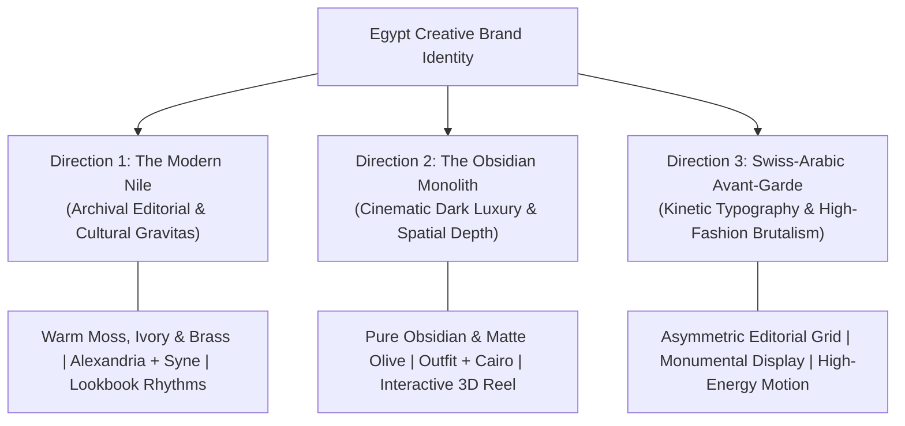

# CREATIVE DIRECTION OPTIONS: THE EGYPT CREATIVE FLAGSHIP
**Target:** International Creative Agency Positioning for Egypt Creative  
**Brand Identity:** Egypt Creative — Premium Creative & Digital Marketing Agency  
**Core Purpose:** Eliminate generic agency tropes; establish an internationally acclaimed, award-winning visual identity.  
**Review Lead:** Senior Creative Director & Principal Brand Strategist  

---

## 1. Why the Current Website Fails Creatively

Forensic deconstruction of `https://egyptcreative.com/` demonstrates why it reads as a generic, regional marketing website rather than an elite international agency:

1. **The Commercial Theme Aesthetic ("The Themeforest Cliché"):**
   - The live site relies on the "Noryx" template. Its visual signifiers—floating circular badges with star ratings, cartoonish social media wheels, and uniform square service boxes—are instantly recognizable as template elements used by thousands of low-budget websites.
2. **Dilution of the Olive Brand Identity:**
   - The approved brand direction calls for an **Original Olive Luxury Palette**. Instead, the live site is populated by generic cold dark-blue tones, stark black-and-white contrasts, and jarring yellow highlight blobs (`#ffe600`). The distinctive natural elegance of the olive tone is completely lost.
3. **Lack of Visual Gravitas in the Hero Section:**
   - Instead of commanding attention with monumental typography and cinematic production authority, the live hero attempts to show everything at once: reviews, WhatsApp links, Google Maps icons, scrolling tickers, and paragraphs of text, creating cognitive fatigue.
4. **Shallow Portfolio Treatment:**
   - Case studies are treated as static thumbnail tiles. World-class agencies (Locomotive, Basic, Instrument) present work as **compelling business narratives** with full-bleed imagery, video breakdowns, interactive prototype embeds, and verified commercial impact metrics.

---

## 2. Three Distinct Creative Directions for Egypt Creative

All three directions strictly preserve the core Egypt Creative brand, leadership, and portfolio assets, but interpret the visual experience through three distinct, internationally competitive design philosophies:

---

### Direction 1: "The Modern Nile" (Archival Editorial & Cultural Gravitas)
* **Design Philosophy:** Grounded luxury celebrating Egyptian creative heritage reimagined for the modern international stage. Blends the intellectual authority of a prestigious design archive with high-end editorial magazines (Kinfolk, Cereal, Vogue Arabia). Warm, timeless, calm, and unmistakably executive.
* **Typography:**
  - *English Display:* **Syne** (700 Bold / 800 Extra Bold) — sculptural, wide, monumental.
  - *Arabic Display:* **Alexandria** (700 Bold / 800 Black) — geometric, authoritative, perfectly balanced with Syne.
  - *Body Copy:* **Outfit** (400 Regular, 18px / 1.7 line-height) paired with **Cairo** (400 Regular, 1.8 line-height).
* **Color System:**
  - *Base Canvas:* Obsidian Black (`#0D0F0C`) and Deep Forest Olive (`#1D2619`).
  - *Secondary Surfaces:* Warm Muted Sage (`#2C3825`) and Egyptian Limestone / Warm Ivory (`#F5F4EE`).
  - *Accent Highlights:* Warm Antique Brass (`#D4AF37`) and Desert Sand (`#E2D9C8`).
* **Homepage Composition:**
  - Generous, serene negative space. Asymmetrical editorial columns where typography and imagery breathe without border constraints. Delicate hairline rules (`rgba(245, 244, 238, 0.12)`) separating sections.
* **Hero Experience:**
  - Monumental, centered typographic headline in warm ivory: *"Building Brands. Creating Impact. Driving Growth."*
  - Below the headline, an embedded ultra-wide 21:9 cinematic video container featuring real commercial production reel footage. Quiet, confident, zero cluttered badges.
* **Portfolio Presentation:**
  - **Full-Width Editorial Lookbook:** Alternating horizontal project rows featuring a 60/40 split between high-definition project imagery and strategic project insights (Client, Scope, Year, Key Metric).
* **Motion Design:**
  - Deliberate, velvet-like transitions. Smooth opacity fades (`350ms ease-out`), subtle vertical parallax on scroll, and a gentle magnetic pull on primary buttons. Zero abrupt bounces or distracting loops.
* **Mobile Behavior:**
  - Stacked editorial cards with large, highly legible Arabic and English headlines. Touch targets expand to generous 48px heights with clear visual separators.

---

### Direction 2: "The Obsidian Monolith" (Cinematic Dark Luxury & Spatial Depth)
* **Design Philosophy:** High-tech, immersive, cinematic prestige. Positions Egypt Creative as a formidable, modern digital powerhouse comparable to Active Theory and Locomotive. Deep, weightless spatial layers, glassmorphism, and cinematic video storytelling.
* **Typography:**
  - *English Display:* **Playfair Display** (Italic 700) paired with **Outfit** (800 Extra Bold Uppercase).
  - *Arabic Display:* **Alexandria** (900 Black) with tight tracking and elevated baseline.
  - *Body Copy:* **Plus Jakarta Sans** (400 Regular) and **Cairo** (400 Regular).
* **Color System:**
  - *Base Canvas:* Pure Deep Midnight (`#080A08`).
  - *Surface Glass:* Translucent Dark Olive Glass (`rgba(22, 29, 20, 0.65)` with 20px blur).
  - *Accents:* Muted Olive Glow (`rgba(126, 148, 114, 0.25)`) and Luminous Platinum (`#E8ECE6`).
* **Homepage Composition:**
  - Layered spatial planes with subtle atmospheric grain. Floating glass cards that react subtly to scroll velocity. Full-bleed dark canvas with razor-thin luminous borders.
* **Hero Experience:**
  - Full-screen interactive video backdrop with an atmospheric dark olive overlay. When the visitor moves their mouse (or tilts mobile gyroscope), the background camera angle subtly responds in 3D perspective.
  - Minimalist floating headline with an integrated play reel button.
* **Portfolio Presentation:**
  - **Interactive Spatial Reel:** Horizontal draggable project carousel with custom WebGL image displacement effects on drag. Hovering over a project expands video previews in real time.
* **Motion Design:**
  - Fluid, physics-based motion. Hardware-accelerated GPU transforms (`translate3d`), responsive cursor trailing rings, and frictionless kinetic momentum scrolling.
* **Mobile Behavior:**
  - Full-screen snap carousel with haptic touch response on project navigation. Zero lag; 60fps mobile GPU rendering.

---

### Direction 3: "Swiss-Arabic Avant-Garde" (Kinetic Typography & High-Fashion Brutalism)
* **Design Philosophy:** Bold, graphic, unapologetic, and hyper-modern (inspired by Koto, Basic Agency, and Pentagram). Uses extreme typographic scale contrasts and rigid architectural grids to signal cutting-edge creative bravery.
* **Typography:**
  - *English Display:* **Syne** (800 Extra Bold) rendered in massive scale with tight letter spacing.
  - *Arabic Display:* **Cairo** (800 Extra Bold / 900 Black) stretched in monumental proportion across viewports.
  - *Body Copy:* **Inter** or **Outfit** (500 Medium) in clean, utilitarian Swiss style.
* **Color System:**
  - *Base Canvas:* Matte Black (`#101210`) and Acidic Olive (`#2E3D24`).
  - *High-Contrast Highlights:* Crisp Pure White (`#FFFFFF`) and Electric Olive Lime (`#88A870`).
  - *Dividers:* Monochromatic grid lines (`rgba(255, 255, 255, 0.15)`).
* **Homepage Composition:**
  - Strict multi-column grid architecture. High typographic tension where massive titles collide with micro-labels (`[01 / WEB DEVELOPMENT]`). Every section feels like an architectural blueprint.
* **Hero Experience:**
  - Massive, kinetic text marquee spanning the entire viewport horizontally in dual languages (English flowing LTR, Arabic flowing RTL in hypnotic harmony).
  - High-impact visual manifesto right in the center.
* **Portfolio Presentation:**
  - **Interactive Split-Grid Index:** Left pane features a sticky, interactive project index list; right pane renders massive, full-height project stills that switch instantaneously on hover.
* **Motion Design:**
  - Snappy, instant micro-interactions (`150ms - 200ms cubic-bezier(0, 0, 0.2, 1)`). Sharp cursor hover inversions and rapid layout reveals.
* **Mobile Behavior:**
  - Full-width architectural cards with horizontal sliding project pills and prominent sticky WhatsApp booking bar.

---

## 3. Creative Recommendation

**We strongly recommend Direction 1: "The Modern Nile" (Archival Editorial & Cultural Gravitas).**

### Why Direction 1 is the Winning Path:
1. **Perfect Brand Alignment:** It honors Egypt Creative's authentic name and regional leadership while projecting the refined luxury of international top-tier creative institutions.
2. **Longevity Over Fad:** Unlike neon high-tech 3D effects (which date rapidly within 18 months), timeless editorial typography and deep olive palettes retain prestige for years.
3. **Flawless Bilingual Execution:** Alexandria and Syne are typographic soulmates; they share identical geometric curvature and optical weight, ensuring that the Arabic and English versions feel equally premium.
