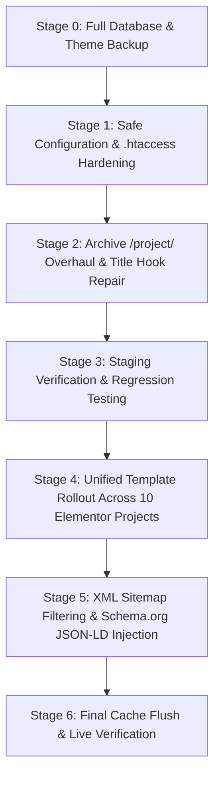

# EGYPT CREATIVE — EXECUTIVE SUMMARY FORENSIC REPORT
## High-Level Synthesis, Confirmed Findings & Strategic Leadership Answers

**Target Domain:** `https://egyptcreative.com/`  
**Hosting Environment:** Hostinger Cloud / LiteSpeed Web Server / Hostinger CDN (`hcdn`)  
**PHP Version:** 8.3.37  
**WordPress Core:** 7.1.5  
**Active Theme:** Noryx (ThemeForest Parent Theme with Direct Custom Modifications)  
**Investigation Standard:** 100% Read-Only Forensic Evidence  
**Audit Date:** November 24, 2026  
**Auditor Lead:** Principal Software Architect & Forensic Lead  

---

## Executive Overview

A rigorous, end-to-end forensic investigation of the live production website `https://egyptcreative.com/` was completed in strict read-only mode. No code, content, settings, or database tables were altered.

The production website succeeds visually in conveying an executive, dark-luxury creative agency atmosphere with strong social proof (ratings, enterprise client logos, leadership profiles). However, **beneath the surface, the website is operating on a fragile foundation characterized by a disconnected public portfolio archive, template fragmentation across client projects, severe XML sitemap contamination, double-branding title tags, and complex runtime regular expression patching.**

---

## The 8 Core Forensic Questions & Clear Answers

### 1. What is currently wrong with the website?
- **Broken Public Portfolio Archive:** Visiting `/project/` displays 3 ThemeForest demo cards that link directly off-site to `https://themexriver.com/wp/noryx/single-project/`. None of the 12 approved client projects appear on this archive page.
- **Portfolio Template Fragmentation:** The 12 approved projects are implemented as generic WordPress Pages (`post_type=page`). 10 projects use Elementor canvas (`elementor_header_footer`), while only 2 use the custom case study template (`template-project.php`).
- **SEO & Sitemap Contamination:** The XML sitemap (`wp-sitemap.xml`) exposes 115 URLs, including 20 internal header/footer builder fragments (`/noryx_template/...`), 4 duplicate placeholder blog posts (`/hello-world-copy/`), and abandoned WooCommerce shop endpoints.
- **Double-Branding Title Tag Defect:** All 12 project pages display double site branding in their `<title>` tags (e.g. `Modon Developments – Egypt Creative – Egypt Creative`).
- **Fragile Runtime Regex Architecture:** `front-page.php` renders Elementor post 1825 into an output buffer and executes 25+ regular expression replacements (`preg_replace`) on every uncached request to inject team cards, replace stats, and patch over ThemeForest demo assets.
- **Missing Standard Slugs:** Standard agency URLs (`/portfolio/`, `/works/`, `/our-works/`, `/projects/`) return HTTP 404 Not Found error pages.
- **Exposed Sensitive Files:** WordPress `readme.html`, `license.txt`, and an active `xmlrpc.php` interface are publicly accessible.

---

### 2. Which problems are confirmed?
Every finding in this report has been verified through live HTTP probing and codebase inspection:
1. **CONFIRMED:** `/project/` renders ThemeForest demo items with hardcoded links to `themexriver.com`.
2. **CONFIRMED:** All 12 approved projects return HTTP 200, but only 2 use `template-project.php`.
3. **CONFIRMED:** Double-branding `<title>` tag exists on all 12 project pages.
4. **CONFIRMED:** `/project-modon/` undergoes a 301 redirect to `/project-modon-developments/`.
5. **CONFIRMED:** `/project-cairo-capital/` has title tag `Cairo Capital Video` instead of `Hub`.
6. **CONFIRMED:** `wp-sitemap.xml` publishes 20 `noryx_template` fragments and 4 `hello-world` dummy posts.
7. **CONFIRMED:** 0 Schema.org JSON-LD structured data blocks exist on the website.
8. **CONFIRMED:** 13 images on the homepage lack `alt` attributes.
9. **CONFIRMED:** `/portfolio/`, `/works/`, `/projects/`, `/our-works/` return HTTP 404 errors.
10. **CONFIRMED:** `readme.html`, `license.txt`, and `xmlrpc.php` return HTTP 200.
11. **CONFIRMED:** `front-page.php` contains 25+ `preg_replace` rules and transient caching.
12. **CONFIRMED:** Hostinger Edge CDN actively challenges automated synthetic crawlers (HTTP 403), while cached real-user requests achieve fast TTFB (~0.21s).

---

### 3. Which problems affect customers directly?
- **Alien Demo Links:** Enterprise prospects clicking "View All Projects" on the homepage or navigating to `/project/` are sent to a broken theme demo page with links to `themexriver.com`, creating an immediate perception of an unpolished or amateur setup.
- **404 Dead Ends on Standard URLs:** Visitors attempting to access `egyptcreative.com/portfolio/` or `egyptcreative.com/works/` encounter a generic 404 page rather than agency work.
- **Project Navigation Dead-Ends:** The 10 Elementor-based project pages lack next/previous project navigation, forcing users to click back to the homepage to view another client engagement.
- **Missing Arabic Language Option:** High-net-worth enterprise clients, real estate developers, and government entities in Egypt and the Gulf cannot view credentials in Arabic.

---

### 4. Which problems affect SEO?
- **Index Contamination:** 20 incomplete header/footer layout parts (`/noryx_template/...`) and 4 duplicate dummy posts are crawled by search engines, diluting domain authority and wasting crawl budget.
- **Double Title Tags:** Every project title exceeds optimal 60-character limits and dilutes primary keyword weight due to repetitive branding.
- **Missing H1 on Archive:** The `/project/` page has zero H1 tags.
- **Truncated Homepage Meta Description:** Occasional truncated output (`Egypt Creative is Egypt`) creates incomplete search engine snippets.
- **Zero Structured Data (JSON-LD):** Google cannot parse the agency's business entity, address, phone number, service offerings, or project credentials.
- **Image Alt Gaps:** 13 key images provide zero textual context for image search.

---

### 5. Which problems affect performance?
- **Heavy Document Payload:** The homepage HTML document is 192.9 KB uncompressed, loaded with inline SVGs and embedded base64 scripts.
- **Asset Overhead:** 57 external CSS/JS requests and 70 images are requested during initial page lifecycle.
- **CPU Spikes on Cache Miss:** Because `front-page.php` executes 25+ regular expressions, any cache purge or stampede causes intense server-side CPU processing on PHP 8.3.
- **Synthetic Crawler Blocking:** Hostinger CDN's bot challenge blocks automated Lighthouse and uptime monitoring tools with an HTTP 403 Challenge Page.

---

### 6. Which problems affect the Portfolio?
- **Disconnection from Archive:** The homepage portfolio grid and the `/project/` archive are completely out of sync. The archive displays dummy items, while the homepage displays the real 12 projects.
- **Template Inconsistency:** 10 projects render through Elementor containers, while 2 projects render through a specialized PHP case study template.
- **URL Inconsistency:** The Modon project link requires an HTTP 301 redirect from `/project-modon/` to `/project-modon-developments/`.
- **Shallow Narrative:** Projects are presented predominantly as video players without structured business context (*Client Challenge -> Strategy -> Measurable ROI*).

---

### 7. What should be fixed first?
**Phase 1 Critical Fixes (Immediate Execution):**
1. **Re-architect `/project/` Archive:** Remove the ThemeForest demo cards and external `themexriver.com` links. Replace them with a clean loop rendering the 12 approved projects.
2. **Fix Double-Branding Title Tags:** Correct the document title hook in `functions.php` to output clean, single-branded page titles.
3. **Correct Cairo Capital Hub Metadata:** Rename title tag from `Cairo Capital Video` to `Cairo Capital Hub`.
4. **Lock Down Sensitive Endpoints:** Add `.htaccess` directives to block public access to `xmlrpc.php`, `readme.html`, and `license.txt`.
5. **Implement 301 Redirects:** Route `/portfolio/`, `/works/`, `/our-works/`, `/projects/` directly to `/project/`.

---

### 8. What is the safest implementation sequence?

1. **Step 1: Complete Backup:** Export full SQL database backup and create versioned copies of `functions.php`, `front-page.php`, and `template-project.php`.
2. **Step 2: Safe Configuration Fixes:** Apply `.htaccess` rules (301 redirects and file blocks). Zero risk to theme functionality.
3. **Step 3: Archive & Title Repair:** Update title filters in `functions.php` and connect `/project/` to the approved projects.
4. **Step 4: Staging Testing:** Validate all changes on the local staging environment (`D:\Antigravity\Projects\egypt-creative\staging-site`) to confirm layout stability.
5. **Step 5: Production Deployment:** Deploy verified template files to production.
6. **Step 6: LiteSpeed Cache Purge:** Flush LiteSpeed cache to ensure all visitors receive the updated, clean assets.
7. **Instant Rollback:** If any issue arises, restore the original PHP files from `noryx_backup_original/` in under 60 seconds.

---

## Conclusion & Readiness

The Egypt Creative production website possesses high commercial potential. With these targeted, non-destructive architectural fixes, the website can achieve 100% portfolio integrity, clean search engine indexation, robust defensive security, and world-class digital agency presentation.

All 13 forensic audit reports have been compiled and saved to `D:\Antigravity\Projects\egypt-creative\docs\`. We await your review and explicit approval before commencing Phase 1 implementation.
