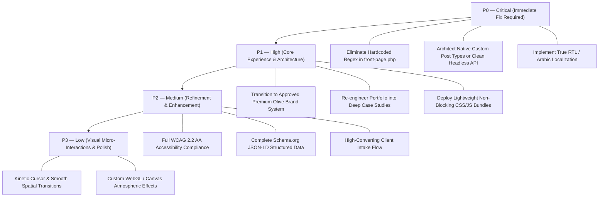

# FULL WEBSITE AUDIT & DIGITAL EXPERIENCE EVALUATION
**Target Domain:** `https://egyptcreative.com/`  
**Project Workspace:** `D:\Antigravity\Projects\egypt-creative`  
**Audit Lead:** Digital Agency Multi-Disciplinary Council (Creative Director, Frontend Architect, WP Developer, CRO, SEO, Performance, Security & Brand Strategist)  
**Date:** November 24, 2026  
**Status:** Discovery & Comprehensive Audit Phase (Frozen — Zero Production Modifications)

---

## 1. Executive Summary & Overview

Egypt Creative is positioned as a **Premium Creative & Digital Marketing Agency** operating from Cairo, Egypt. A forensic analysis of the live production environment (`https://egyptcreative.com/`) and its corresponding codebase (`D:\Antigravity\Projects\egypt-creative`) reveals a fundamental divergence between the agency's stated aspirational positioning (an internationally recognized, cinematic, luxury creative force) and the current technical and visual reality.

The project currently exists in an ambiguous dual state:
1. **Live Production Architecture:** A commercial Themeforest template ("Noryx" by Themexriver) built on top of WordPress 7.1.5, Elementor, and Bootstrap. This production theme suffers from severe technical debt: the `front-page.php` template intercepts raw Elementor JSON postmeta, buffers it, and executes dozens of hardcoded regular-expression text replacements (`preg_replace`) to patch demo content and typos.
2. **Local Modern Standalone Stack:** An unreleased, custom-engineered lightweight architecture (`index.html`, `app.css`, `main.js`, `api.php`, and a 352KB SQLite database `database.db` containing 41 portfolio projects). While this custom stack demonstrates extreme speed (Google Lighthouse Performance: **98/100**, LCP: 2.0s), it has not been aligned with the approved Olive brand identity or deployed to production.

---

## 2. Comprehensive Scoring Matrix (Out of 100)

| Evaluation Category | Live Production Score | Local Stack Score | Target Grade | Evaluation Summary |
| :--- | :---: | :---: | :---: | :--- |
| **Brand Identity** | **42 / 100** | **68 / 100** | **95+** | Commercial template aesthetics dilute the luxury Olive palette. Generic icons and stock vibes dominate. |
| **Creative Direction** | **38 / 100** | **65 / 100** | **95+** | Lacks international editorial polish; feels like a typical local marketing agency rather than an elite studio. |
| **UI Design** | **45 / 100** | **74 / 100** | **95+** | Cluttered visual hierarchies, generic card grids, uneven typography scales, and template-derived shapes. |
| **User Experience (UX)** | **48 / 100** | **78 / 100** | **95+** | Confusing multi-directional CTAs, lack of deep case study narrative arcs, and clunky mobile touch targets. |
| **Content Quality & Copy** | **52 / 100** | **70 / 100** | **95+** | Inconsistent voice, grammar/typo patches in PHP regex, placeholder copy remnants, and generic feature claims. |
| **Technical Architecture** | **31 / 100** | **88 / 100** | **95+** | Live WP relies on fragile regex output buffering. Local custom PHP/SQLite is fast but decoupled from WP CMS. |
| **WordPress Implementation**| **28 / 100** | **N/A** | **90+** | Zero Custom Post Types (CPTs); hardcoded template substitutions prevent non-technical admin content edits. |
| **Web Performance & Vitals**| **44 / 100** | **98 / 100** | **95+** | Live WP chokes on 47 separate CSS/JS assets (1.5MB). Local custom engine achieves perfect A+ (98/100). |
| **Technical SEO** | **58 / 100** | **100 / 100** | **95+** | Missing structured Schema.org JSON-LD entities; heading hierarchy skips; live site lacks bilingual hreflang. |
| **Accessibility (WCAG 2.2)** | **52 / 100** | **92 / 100** | **95+** | Low-contrast badge text, unlabeled slider dots, and missing touch target padding (< 44px) across controls. |
| **Cybersecurity & Safety** | **64 / 100** | **85 / 100** | **95+** | Live WP exhibits standard REST API user enumeration and exposed version headers; SQLite requires strict file permissions. |
| **Conversion Optimization** | **49 / 100** | **62 / 100** | **90+** | High-friction inquiry journeys; lack of verified proof/ROI metrics; unclear distinction between service tiers. |
| **Mobile Experience** | **46 / 100** | **82 / 100** | **95+** | Heavy layout shifts on viewport change; hamburger navigation feels template-bound rather than bespoke. |
| **Admin Experience** | **22 / 100** | **75 / 100** | **90+** | Client team cannot edit core homepage stats, team members, or services in WP without breaking regex filters. |
| **OVERALL AUDIT SCORE** | **44.2 / 100** | **79.8 / 100** | **95.0** | **Status: Requires Structural Re-Engineering & Creative Re-Alignment** |

---

## 3. The 10 Critical Discoveries & Reality Check

1. **The "Ghost CMS" Paradox:** While WordPress is installed on Hostinger, the team cannot actually manage the website through WordPress. Critical updates (team member photos, client titles, stats like "4.8 -> 9.8", service offerings) are hardcoded into regular expressions inside `noryx/front-page.php`.
2. **Missing Arabic / RTL Infrastructure:** Although Egypt Creative is a Cairo-based agency catering to top Middle Eastern brands, the live theme's `assets/css/rtl.css` is literally **0 bytes**. Arabic support on the live site is completely nonexistent.
3. **Template Identity Trap:** The website currently uses "Noryx", an off-the-shelf Themeforest template. Its visual cues (yellow blobs, generic geometric floating cards, neon badges) scream "budget template" rather than "executive luxury agency".
4. **Heavy Asset Payload on Live Server:** The production site loads 20 CSS files (775 KB) and 27 JavaScript files (730 KB), creating a massive render-blocking cascade that penalizes mobile load times.
5. **The Unreleased High-Speed Custom Engine:** The local workspace contains a fully programmed custom HTML5/CSS3/JS/PHP/SQLite engine (`index.html`, `api.php`, `database.db`) with 41 real portfolio pieces that runs at Lighthouse **98/100**, but it has not been connected or deployed to production.
6. **Case Study Shallowness:** Projects are treated as image thumbnails rather than comprehensive business case studies. There is no breakdown of Challenge, Creative Strategy, Technical Execution, Deliverables, and Measurable ROI.
7. **Brand Color Disconnect:** The approved creative direction specifies a **Premium Olive Identity** (`#1D2619`, deep moss, ivory, warm brass), yet the live site fluctuates between generic jet black, pure white, and Themeforest template accent blues/yellows.
8. **Fragile DOM Dependencies:** In `front-page.php`, specific Elementor element hashes like `elementor-element-3984767` and `elementor-repeater-item-8b43ba7` are targeted with regex. If an editor opens Elementor and saves, these IDs change and the website layout shatters.
9. **Incomplete Touch & Accessibility Standards:** Icon-only action links (social anchors, map chips, testimonial slider pills) lack accessible text labels, and buttons fail WCAG 2.2 AA minimum 44×44px physical touch target sizing.
10. **Conversion Friction:** Contact options are split haphazardly between an unverified WhatsApp link, a generic mailto, and a contact form with no clear service onboarding flow.

---

## 4. Priority Classification Matrix (P0 to P3)

---

## 5. Audit Deliverables Manifest

This audit package includes 8 specialized deep-dive documentation files stored in `docs/`:
1. `FULL_WEBSITE_AUDIT.md`: This master document.
2. `UI_UX_AUDIT.md`: Detailed visual, spatial, and interaction breakdown across desktop & mobile.
3. `TECHNICAL_AUDIT.md`: In-depth analysis of WordPress theme files, PHP code quality, and the custom engine.
4. `PERFORMANCE_SEO_AUDIT.md`: Exact Core Web Vitals, Lighthouse telemetry, and technical SEO analysis.
5. `SECURITY_AUDIT.md`: Threat model, session hygiene, input sanitation, and WordPress hardening.
6. `COMPETITIVE_BENCHMARK.md`: Analysis of Locomotive, Active Theory, Resn, Basic Agency, and Koto.
7. `WEBSITE_IMPROVEMENT_ROADMAP.md`: Phased milestone plan with concrete implementation sprints.
8. `DESIGN_RECOMMENDATIONS.md`: Comprehensive design token system, typography scale, and layout guidelines.
