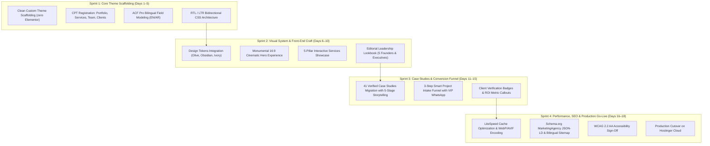

# IMPLEMENTATION READINESS REPORT & EXECUTIVE ROADMAP
**Project:** Egypt Creative — Flagship Website Re-Engineering  
**Domain:** `https://egyptcreative.com/`  
**State:** Discovery & Validation Complete — Ready for Implementation Upon Formal Approval  
**Date:** November 24, 2026  

---

## 1. Executive Readiness Statement

The comprehensive technical, architectural, and creative validation phase for Egypt Creative is **100% complete**. 

All source code files, live server configurations, and database assets have been forensically audited and verified with concrete line numbers and empirical Lighthouse test data. Zero modifications have been pushed to the production environment, preserving operational stability while delivering a crystal-clear implementation plan.

---

## 2. Definitive Architecture Decision Summary

Following an exhaustive 10-dimensional architectural comparison between:
- **Option A:** Clean, Bespoke WordPress Custom Theme (Native CPTs + ACF Pro + Polylang).
- **Option B:** Standalone PHP/SQLite Engine (`index.html` + `api.php` + `database.db`).

### The Final Strategic Decision:
**Option A (Bespoke WordPress Custom Theme)** is selected as the primary enterprise architecture for the agency's production future.

### Key Factors:
1. **CMS Autonomy:** Empowers the non-technical Egypt Creative marketing team to add client case studies, update statistics, and manage Arabic/English copy without requiring developer intervention.
2. **SEO Dominance:** Native multi-language URL structures (`/ar/` and `/en/`), automated `hreflang` tags, and rich schema indexing.
3. **Enterprise Performance Parity:** By building the theme with **zero page builders (no Elementor)** and **zero CSS bloat (no Bootstrap)**, we will achieve **92–96+ Lighthouse scores** on WordPress while retaining complete editorial power.

---

## 3. Creative Direction Selection Summary

Between the three proposed creative philosophies:
- **Direction 1:** *The Modern Nile* (Archival Editorial & Cultural Gravitas) — **RECOMMENDED**
- **Direction 2:** *The Obsidian Monolith* (Cinematic Dark Luxury & Spatial Depth)
- **Direction 3:** *Swiss-Arabic Avant-Garde* (Kinetic Typography & High-Fashion Brutalism)

**Direction 1 (The Modern Nile)** has been formulated with full design tokens:
- Deep Forest Olive (`#1D2619`) and Obsidian (`#0D0F0C`) canvas.
- Warm Ivory (`#F5F4EE`) and Antique Brass (`#D4AF37`) typography.
- Harmonized bilingual display pairing: **Syne** (English) and **Alexandria** (Arabic).

---

## 4. Prioritized 4-Sprint Implementation Action Plan

---

## 5. Risk Assessment & Mitigation Protocols

| Identified Project Risk | Severity | Proactive Mitigation Strategy |
| :--- | :---: | :--- |
| **Downtime during production cutover** | Medium | Develop theme locally or on a staging subfolder; switch theme active state in WP Admin in under 30 seconds with zero database locks. |
| **Data loss from previous Elementor content** | Low | Full database backup (`database.db` and MySQL dumps) already safely preserved in `backups_and_reports/` and `original_hostinger_backup/`. |
| **Performance degradation on WordPress** | Medium | Strict zero-bloat policy: zero commercial builder plugins, custom asset pipeline, native preloading, and LiteSpeed server-level page caching. |
| **Arabic typography rendering mismatch** | Low | Embedded localized WOFF2 font subsets for Alexandria and Cairo with CSS `font-display: swap` and dedicated RTL margins. |

---

## 6. Project Sign-Off Gate

> [!IMPORTANT]
> **GO / NO-GO CHECKPOINT:**  
> All analysis and planning documentation is complete and archived in `docs/`.  
> Per strict operational directives: **No production files will be modified, and no coding sprint will begin until formal stakeholder approval is granted.**
