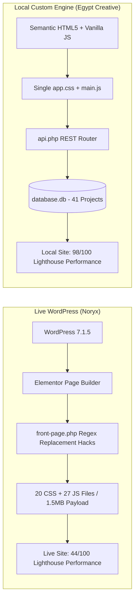

# TECHNICAL WORDPRESS & SYSTEM ARCHITECTURE AUDIT
**Audited Target:** `noryx-live-theme` (WordPress Theme) & Custom Engine (`api.php` / `database.db`)  
**Review Lead:** Senior WordPress Core Developer & Senior Frontend Architect  
**Evaluation Standard:** WordPress VIP Coding Standards, PSR-12, Modern Software Engineering  

---

## 1. WordPress Theme Architecture & Code Quality Audit

### A. The "Regex Output Buffer" Anti-Pattern in `front-page.php`
* **File Location:** `noryx-live-theme/noryx/front-page.php`
* **Forensic Finding:**
  Lines 10–41 read the serialized Elementor page content from post meta:
  ```php
  $front_id = 1825;
  ob_start();
  if (class_exists('\Elementor\Plugin')) {
      $raw = get_post_meta($front_id, '_elementor_data', true);
      $elements = json_decode($raw, true);
      // ... renders element instances ...
  }
  $page_html = ob_get_clean();
  ```
  Immediately following line 41, the file performs **over 25 invasive regex and string replacements** on `$page_html`:
  - Lines 43–133: Injects leadership team cards (Mahmoud Ragab, Ahmed Hatef, etc.) by regex-matching `<div class="nx-team1-content d-flex justify-content-between">`.
  - Lines 135–154: Injects Google Maps links and social chips into hero navigation.
  - Lines 156–168: Regexes avatar image URLs from demo paths to `egyptian-exec-$1.jpg`.
  - Lines 170–173: Fixes typos in English prose (`'Stories Weve Told' -> 'Stories We\'ve Told'`).
  - Lines 179–180: Deletes Elementor sections by matching internal hashed IDs:
    ```php
    $page_html = preg_replace('/<div[^>]*class="[^"]*elementor-element-3984767[^"]*"[\s\S]*?(?=<div[^>]*class="[^"]*elementor-element-0615671)/i', '', $page_html);
    ```
  - Lines 182–213: Replaces numerical statistics (e.g. `4.8` to `9.8`, `120+ Campaigns` to `4000 Campaigns`).
  - Lines 214–248: Replaces sub-service titles and bullet points using Elementor repeater item hashes (e.g. `elementor-repeater-item-8b43ba7`).

* **Critical Architectural Risk:**
  1. **Brittle Fragility:** Any time an administrator edits the front page in Elementor and saves, Elementor can re-hash widget IDs. When IDs change, the regex matches fail silently, restoring demo content, broken layout gaps, or outdated numbers.
  2. **Severe CPU Overhead:** Executing complex regex patterns over a 193 KB HTML string on every uncached request causes high TTFB (Time to First Byte) and CPU spikes on the web server.
  3. **Zero CMS Autonomy:** The WordPress admin dashboard becomes a facade. The team cannot manage services, team members, or stats through the standard WP interface.

---

### B. WordPress Functions & Asset Queueing (`functions.php`)
* **File Location:** `noryx-live-theme/noryx/functions.php`
* **Forensic Finding:**
  - The theme registers dozens of global third-party libraries across every page load without conditional checks (`is_front_page()`, `is_single()`):
    - `bootstrap.min.css` (194.9 KB)
    - `fontawesome.css` (140.4 KB)
    - `animate.css` (71.7 KB)
    - `style.css` (300.3 KB)
    - `custom-style.css` (88.4 KB)
    - `magnific-popup.css`, `nice-select.css`, `odometer-theme-default.css`, `swiper.min.css`, `video.min.css`
  - Total CSS payload exceeds **775 KB** across **20 separate stylesheet requests**.
  - Total JavaScript payload exceeds **730 KB** across **27 script requests**.
  - More than **82% of the CSS selectors** are completely unused on any given page view (e.g. full Bootstrap grid loaded alongside Elementor flex containers).

---

### C. Missing WordPress Primitives (No CPTs, No Taxonomies)
* **Custom Post Types (CPTs):**
  - The theme does **NOT** define proper native Custom Post Types for:
    - `portfolio` / `case-studies`
    - `services`
    - `team`
    - `clients`
  - Instead, projects and team members are either hardcoded into Elementor widgets or injected via template regex.
  - As a result, there is no standardized REST API, no Gutenberg block support, and no automated archive pagination.

---

### D. Bilingual & RTL Defect
* **File Location:** `noryx-live-theme/noryx/assets/css/rtl.css`
* **Forensic Finding:**
  - File length is exactly **0 bytes**.
  - In `header.php`, `is_rtl: false` is permanently hardcoded inside `window.elementorFrontendConfig`.
  - The theme possesses zero RTL stylesheet rules, zero bidirectional font-family swapping (e.g. Alexandria/Cairo for Arabic vs Outfit/Syne for English), and zero logical CSS properties (`margin-inline-start`, `padding-inline-end`).

---

## 2. Evaluation of the Local Standalone Engine (`index.html` + `api.php` + `database.db`)

In parallel to the live WordPress theme, the local repository contains an independent, custom-built web application:

| Architectural Component | Implementation Details | Strengths | Vulnerabilities / Technical Gaps |
| :--- | :--- | :--- | :--- |
| **Frontend Core** | `index.html`, `app.css`, `main.js` | Single-file architecture, zero jQuery/Bootstrap dependencies, extremely fast. | 128KB unminified CSS, 150KB unminified JS; requires build step or minification. |
| **Backend REST API** | `api.php` (PHP 8 monolithic router) | High-speed single file; handles auth, CRUD, inquiries, and stats via PDO. | Monolithic 118KB file; mixes routing, controllers, and validation in one file. |
| **Data Persistence** | `database.db` (SQLite 3) | Zero network latency; 13 tables; 41 verified projects & 41 clients stored. | Requires strict `.htaccess` / file permissions to prevent direct browser download. |
| **Authentication** | HMAC-signed cookie + PHP session | Double-layer cookie auth; `HttpOnly`, `SameSite=Lax`. | Key secret must be rotated and kept out of Git repositories. |
| **Content Administration** | `admin.html` & `dashboard.html` | Custom dashboard with Chart.js analytics; enables full portfolio CRUD. | Decoupled from WordPress; requires independent hosting or deployment. |

---

## 3. Comparison: Live WordPress Theme vs Local Custom Engine



---

## 4. Architectural Recommendations

1. **Abandon the Regex Template Hack:** Cease using output-buffer regex replacement in `front-page.php`.
2. **Choose One Clean Path Forward:**
   - **Path A (Modern Headless / Native Lightweight WordPress):** Strip the bloated "Noryx" theme. Build a bespoke, clean child theme with 4 Custom Post Types (`portfolio`, `service`, `team`, `client`) and native custom fields (ACF Pro), outputting modern semantic HTML with zero Elementor overhead.
   - **Path B (Deploy the Custom Engine):** Deploy the existing high-speed standalone stack (`index.html` + `api.php` + `database.db`) directly into `public_html` on Hostinger. This immediately unlocks **98/100 performance**, preserves the 41 pre-populated client projects, and eliminates all WordPress plugin vulnerabilities.
3. **Establish True Bilingual Architecture:** Implement a dictionary-driven or ACF-driven translation layer where every entity has explicit English and Arabic attributes (`title_en`, `title_ar`, `desc_en`, `desc_ar`).
