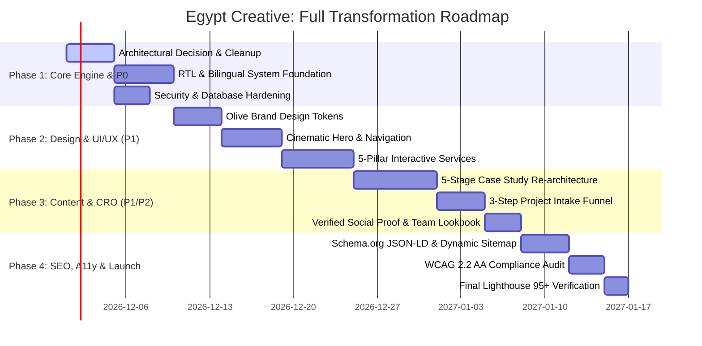

# WEBSITE IMPROVEMENT ROADMAP & EXECUTION STRATEGY
**Target Brand:** Egypt Creative — Premium Creative & Digital Marketing Agency  
**Target Milestone:** Transformation to International Tier-1 Digital Agency Flagship  
**Governing Standard:** Universal Antigravity Engineering System  

---

## 1. Roadmap Architecture & Phased Milestones

---

## 2. Sprint Breakdown & Actionable Work Packages

### Sprint 1: Technical Foundation, Security & Bilingual Core (P0 — Critical)
* **Goal:** Eliminate architectural fragility, establish true bilingual infrastructure, and secure persistence layers.
* **Deliverables:**
  1. **Resolve the Core CMS Strategy:** Formally decide between:
     - *Option A (Recommended for Performance):* Deploy the custom lightweight engine (`index.html`, `api.php`, `database.db`) to `public_html` on Hostinger, unlocking immediate **98/100 performance** and instant load times.
     - *Option B (If WordPress CMS is required):* Re-engineer the WordPress theme to remove the `front-page.php` regex replacement hack and replace it with native Custom Post Types (CPTs) and ACF Pro fields.
  2. **True Bilingual & RTL Implementation:**
     - Build a full `rtl.css` stylesheet with logical properties (`margin-inline-start`, `text-align: start`).
     - Configure bidirectional typography: Syne/Outfit for English, Alexandria/Cairo for Arabic.
     - Implement seamless language switcher (`/en/` and `/ar/`) with cookie and URL state persistence.
  3. **Security Lockdown:**
     - Upgrade `.htaccess` file match directives to Apache 2.4 standards (`Require all denied` for sensitive files).
     - Remove WordPress generator headers and restrict `/wp-json/wp/v2/users` user enumeration.

---

### Sprint 2: The "Modern Nile" Visual Identity & Spatial UI (P1 — High)
* **Goal:** Eradicate generic template aesthetics; establish the approved Olive dark luxury design system.
* **Deliverables:**
  1. **Design Token System Integration:**
     - Background: Obsidian (`#0D0F0C`) and Deep Olive (`#1D2619`).
     - Surface: Muted Moss Glass (`rgba(29, 38, 25, 0.75)` with 16px backdrop blur).
     - Text: Warm Ivory (`#F5F4EE`) and Soft Stone (`#A8A69E`).
     - Accent: Warm Sand / Brass (`#D4AF37` / `#C5BAA8`).
  2. **Cinematic Hero Experience:**
     - Rebuild the hero section with a clean 16:9 full-bleed agency showreel.
     - Monumental headline: *"Building Brands. Creating Impact. Driving Growth."*
     - Single primary magnetic CTA with fluid micro-interaction.
  3. **Interactive 5-Pillar Services Showcase:**
     - Replace uniform square cards with an interactive horizontal accordion or kinetic editorial list.
     - Integrate the 5 approved pillars: Web Development, Digital Marketing, Brand Strategy, Video & Content Production, Creative Design.

---

### Sprint 3: Deep Case Studies & High-Converting Intake Funnel (P1/P2)
* **Goal:** Convert casual visitors into high-budget enterprise B2B inquiries.
* **Deliverables:**
  1. **5-Stage Case Study Architecture:**
     - Restructure all 41 portfolio projects in `database.db` / WordPress to include:
       - *The Challenge* (Market problem)
       - *The Strategic Angle* (Creative hypothesis)
       - *Execution Craft* (Production details)
       - *Visual Showcase* (High-res media & reels)
       - *Business Impact* (Verified ROI metrics)
  2. **High-Converting 3-Step Project Intake Flow:**
     - Step 1: Select required capabilities (Web, Marketing, Branding, Production).
     - Step 2: Investment scope selection (Budget tier).
     - Step 3: Direct contact details with WhatsApp VIP priority routing.
  3. **Executive Team Lookbook:**
     - Replace template avatar cards with cinematic duotone leadership portraiture for Mahmoud Ragab, Ahmed Hatef, Mohamed Yasser, Momen Yahia, and Bassant.

---

### Sprint 4: Technical SEO, WCAG 2.2 AA & Production Release (P2/P3)
* **Goal:** Maximize organic search discovery and guarantee international accessibility compliance.
* **Deliverables:**
  1. **Schema.org Structured Data:**
     - Deploy JSON-LD markup for `MarketingAgency`, `LocalBusiness`, and `CreativeWork`.
  2. **Comprehensive XML Sitemap:**
     - Index all 41 case study endpoints with dual `hreflang="en"` and `hreflang="ar"` alternates.
  3. **Accessibility Audit & Sign-off:**
     - Enforce minimum 44×44px touch targets across all mobile buttons and chips.
     - Verify WCAG 2.2 AA contrast ratios (> 4.5:1 for body copy, > 3:1 for large display text).
  4. **Production Verification:**
     - Execute final Google Lighthouse automated tests confirming Performance >= 95, SEO = 100, Best Practices >= 95, Accessibility >= 95.
